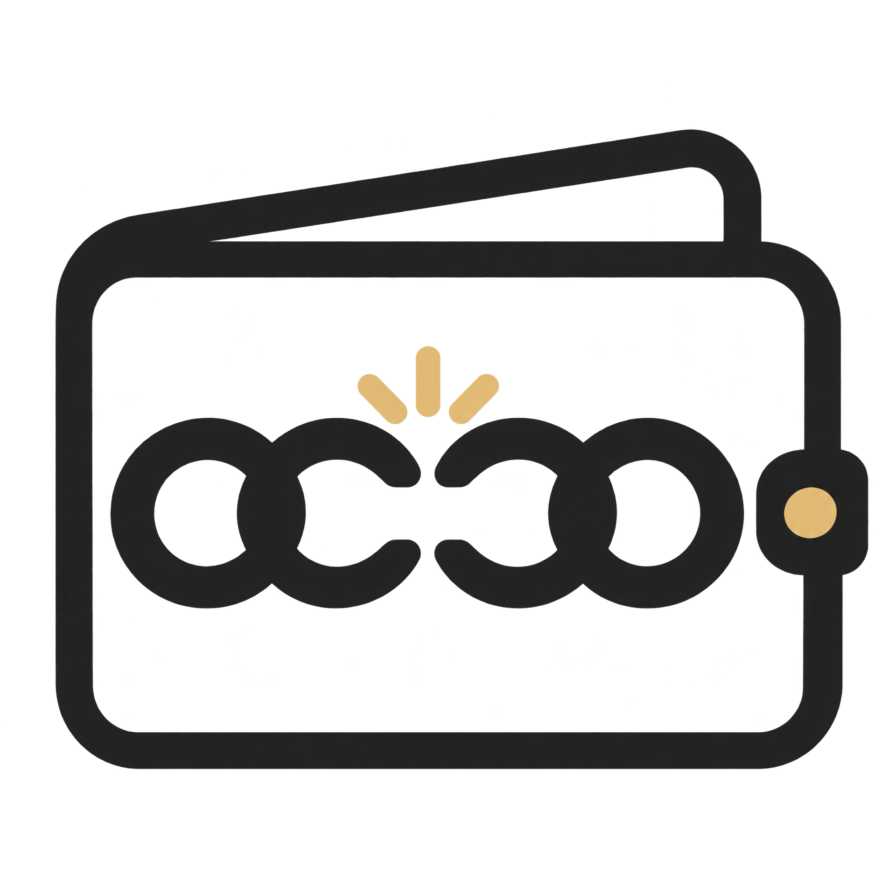
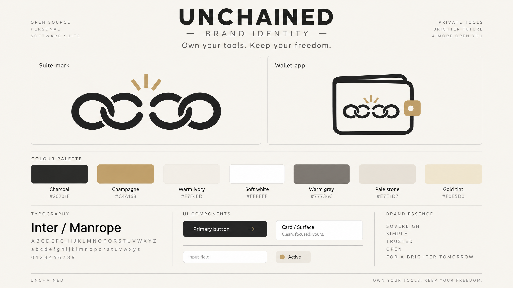

<p align="center">
  
</p>

<h1 align="center">Unchained Wallet</h1>

<p align="center">
  <strong>Own your tools. Keep your freedom.</strong>
</p>

<p align="center">
  A free, open-source personal finance app that helps you track spending, manage budgets, and understand where your money goes. Built with privacy and user control in mind — transparent, self-hostable, and yours to use on your terms.
</p>

<p align="center">
  
  
  
  
</p>

---

## ✨ Features

- **📊 Dashboard** — See your total balance, monthly income vs. expenses, and recent transactions at a glance
- **💳 Transaction Tracking** — Log income and expenses with categories, dates, and notes
- **📋 Budget Management** — Set monthly budgets by category and track progress with visual indicators
- **📈 Analytics** — Understand your spending patterns with category breakdowns and monthly trends
- **📱 PWA** — Install on your phone or desktop, works offline
- **🔒 100% Private** — All data stays in your browser. No server, no tracking, no analytics
- **📤 Export & Import** — Back up your data as JSON anytime
- **🎨 Premium Design** — Clean, calm interface with the Unchained brand identity

## 🖼️ Brand

Unchained Wallet is part of the **Unchained** open-source software suite. All apps share the four-link broken chain mark with a champagne gold burst. See [`DESIGN.md`](DESIGN.md) for the full design system, color palette, and component guidelines.

<p align="center">
  
</p>

## 🚀 Getting Started

### Prerequisites

- [Node.js](https://nodejs.org/) 20+
- npm, yarn, or pnpm

### Install & Run

```bash
# Clone the repo
git clone https://github.com/your-username/unchained-wallet.git
cd unchained-wallet

# Install dependencies
npm install

# Start development server
npm run dev
```

Open [http://localhost:3000](http://localhost:3000) in your browser.

### Build for Production

```bash
npm run build
npm start
```

## 🏗️ Tech Stack

| Technology | Purpose |
|---|---|
| [Next.js 16](https://nextjs.org) | React framework with App Router |
| [Tailwind CSS 4](https://tailwindcss.com) | Utility-first styling |
| [Framer Motion](https://www.framer.com/motion/) | Animations & transitions |
| [Inter](https://rsms.me/inter/) | Typography |
| [Lucide React](https://lucide.dev) | Icons |
| [TypeScript](https://www.typescriptlang.org) | Type safety |

## 📁 Project Structure

```
unchained-wallet/
├── app/
│   ├── layout.tsx              # Root layout (font, theme, navigation)
│   ├── page.tsx                # Dashboard
│   ├── manifest.ts             # PWA web app manifest
│   ├── globals.css             # Tailwind config + brand tokens
│   ├── transactions/
│   │   └── page.tsx            # Transaction list & management
│   ├── budgets/
│   │   └── page.tsx            # Budget tracking
│   ├── analytics/
│   │   └── page.tsx            # Spending analytics
│   ├── settings/
│   │   └── page.tsx            # App settings
│   ├── components/             # Shared UI components
│   └── lib/                    # Data store, types, utilities
├── public/
│   ├── unchained-wallet-matching-chain-logo.png
│   ├── unchained-broken-chain-logo.png
│   └── unchained-brand-board-gpt-image-2-5.png
├── DESIGN.md                   # Full design system & brand guide
└── README.md
```

## 📱 PWA & Offline Support

Unchained Wallet is a Progressive Web App:

- **Install it** on your home screen (iOS, Android, desktop)
- **Works offline** — all data is stored locally in your browser
- **No account needed** — start tracking immediately
- Uses Next.js 16's native `useOffline` hook for connectivity-aware UI

## 🔒 Privacy

Your financial data never leaves your device:

- **No server** — everything runs client-side
- **No analytics** — zero tracking scripts
- **No accounts** — no sign-up required
- **Export anytime** — download your data as JSON
- **Self-hostable** — deploy your own instance

## 🎨 Design System

See [`DESIGN.md`](DESIGN.md) for the complete design reference including:

- Color palette & usage rules
- Typography scale
- Component specifications
- Animation guidelines
- Logo usage rules

## 🤝 Contributing

Contributions are welcome! Please read the design system in [`DESIGN.md`](DESIGN.md) before making UI changes to ensure brand consistency.

1. Fork the repository
2. Create your feature branch (`git checkout -b feature/amazing-feature`)
3. Commit your changes (`git commit -m 'Add amazing feature'`)
4. Push to the branch (`git push origin feature/amazing-feature`)
5. Open a Pull Request

## 📄 License

This project is open-source and available under the [MIT License](LICENSE).

---

<p align="center">
  <sub>Part of the <strong>Unchained</strong> open-source software suite</sub><br />
  <sub>Private tools · Brighter future · A more open you</sub>
</p>
